[README_v2.md](https://github.com/user-attachments/files/34400831/README_v2.md)
<div align="center">



<br>


</div>


## 🖥️ Terminal

```bash
jonas@debian:~$ neofetch

       _,met$$$$$gg.          jonas@debian
    ,g$$$$$$$$$$$$$$$P.       ------------
  ,g$$P"     """Y$$.".        Rol ......... Desarrollador Web Frontend
 ,$$P'              `$$$.     OS .......... Debian GNU/Linux
',$$P       ,ggs.     `$$b:   Lenguajes ... HTML5, CSS3, JS, Python
`d$$'     ,$P"'   .    $$$    Enfoque ..... Páginas web responsivas
 $$P      d$'     ,    $$P    Editor ...... VS Code / Terminal
 $$:      $$.   -    ,d$$'    Mantra ...... Código limpio, diseño con alma
 $$;      Y$b._   _,d$P'
 Y$$.    `.`"Y$$$$P"'
 `$$b      "-.__
  `Y$$b
   `Y$$.
     `$$b.
       `Y$$b.
          `"Y$b._
              `"""
```


## 🌌 Sobre Mí

- 🌐 Creo **páginas web** que transforman ideas en interfaces funcionales, atractivas y responsivas.
- 🎨 Me apasiona la **maquetación limpia** con **HTML5 y CSS3**.
- ⚙️ Doy vida a las páginas con **JavaScript** y automatizo con **Python**.
- 🐧 Mi hogar es **Debian**: estable, libre y a mi medida.
- 🌱 Siempre aprendiendo algo nuevo.


## 🛰️ Stack

<div align="center">


</div>


## 📡 Estadísticas

<div align="center">


<br>


</div>


## 🚀 Proyectos

<details open>
<summary><b>🌐 Mi Portafolio</b></summary>
<br>

Página personal donde muestro mis trabajos y habilidades.

`HTML` `CSS` `JavaScript`

</details>

<details>
<summary><b>🛒 Tienda Demo</b></summary>
<br>

Maqueta de e-commerce responsiva y moderna.

`HTML` `CSS` `JavaScript`

</details>

<details>
<summary><b>🐍 Script Útil</b></summary>
<br>

Automatización de tareas en Linux.

`Python` `Bash`

</details>

> 💡 Cambia estos por tus proyectos reales y agrega el enlace de cada uno.


<div align="center">

## 📫 Contacto

[](https://github.com/jonas-sudo575)

<br>

```bash
jonas@debian:~$ echo "Gracias por pasar por mi galaxia 🌌"
Gracias por pasar por mi galaxia 🌌
```


</div>
