[README.md](https://github.com/user-attachments/files/34401123/README.md)

 

 

 

- 🌐 Creo **páginas web** que transforman ideas en interfaces funcionales, atractivas y responsivas.
- 🎨 Me apasiona la **maquetación limpia** con **HTML5 y CSS3**.
- ⚙️ Doy vida a las páginas con **JavaScript** y automatizo con **Python**.
- 🐧 Mi hogar es **Debian**: estable, libre y a mi medida.
- 🌱 Siempre aprendiendo algo nuevo.

 

 

 

 

 

 

 

 

 

 

<table>
<tr>
<td width="33%" valign="top">

### 🌐 Mi Portafolio
Página personal donde muestro mis trabajos y habilidades.

`HTML` `CSS` `JavaScript`

</td>
<td width="33%" valign="top">

### 🛒 Tienda Demo
Maqueta de e-commerce responsiva y moderna.

`HTML` `CSS` `JavaScript`

</td>
<td width="33%" valign="top">

### 🐍 Script Útil
Automatización de tareas en Linux.

`Python` `Bash`

</td>
</tr>
</table>

> 💡 Cambia estos tres por tus proyectos reales y agrega el enlace de cada uno.

 

 

<!--  -->
<!--  -->

 

